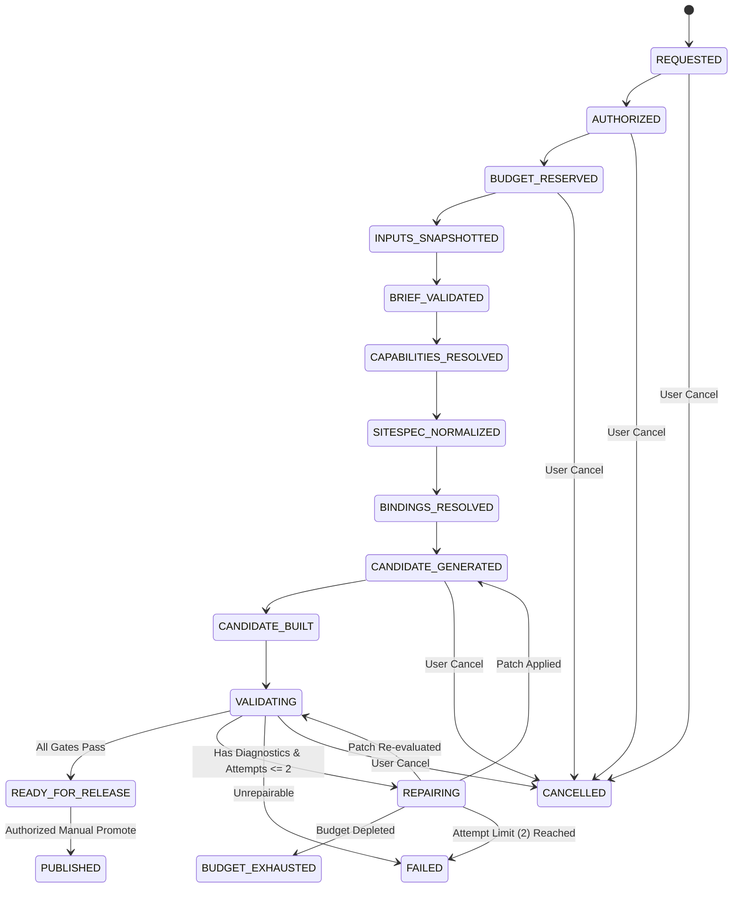

# ForgeStudio Architecture Blueprint: Point 07
# Reliable Generation and Controlled AI Assistance

**Status:** IMPLEMENTED AND INTEGRATED  
**Controlling Blueprint:** `07 | Reliable generation and controlled AI assistance`  
**Prerequisites:** Point 01–06 Authoritative Records, Capability Manifest, Compiler Pipeline  
**Execution Ledger Version:** 2.3.0  

---

## 1. Executive Summary & Purpose

Point 07 implements a production-grade, governed lifecycle for AI-assisted website generation and repair. Rather than treating generation as an ad-hoc chain of unbounded model calls, ForgeStudio enforces:
- **Durable Generation-Job State Machine**: Explicit legal states, validated transitions, worker fencing tokens, and lease expiry to prevent stale workers from mutating or promoting candidates.
- **Upfront Budget Reservation**: Atomic cost estimation and spend reservation prior to invoking any AI provider, bounded by tenant and per-job spending ceilings, with accurate cost reconciliation and refunding of unused reservations upon settlement.
- **Immutable Input Snapshots**: Pinning Point 06 Authoritative Records (Facts, SiteSpec, Source Manifest, Content Schema) and Point 05 Capability Profiles into a cryptographic hash snapshot before generation starts.
- **Centralized Provider Gateway**: Versioned model routing, task-specific routing policies, fallback preservation of data-handling constraints, and redacting sensitive data.
- **Typed Patch Contract**: Treating AI output strictly as untrusted proposals subject to an allowlist of permissible operations (`ADD_SITESPEC_COMPONENT`, `UPDATE_DESIGN_TOKEN`, `BIND_ACTION_TARGET`, etc.) while rejecting forbidden mutations (direct release pointer modifications, test suppression, protected source edits).
- **Point 06 Compiler Integration**: Compiling isolated candidates through the 12-pass deterministic compiler pipeline.
- **Independent Validation & Actionable Diagnostics**: Independent deterministic validation (route reachability, action delivery, accessibility, source preservation) returning machine-readable, redacted diagnostics.
- **Bounded Repair Controller**: Strictly capped at **maximum two repair attempts per candidate** by default. Only the platform policy owner may modify this limit. Failed candidates are preserved; the active release pointer remains untouched.
- **AI-Independent Deterministic Regeneration**: Rebuilding saved websites from authoritative records with zero AI provider calls.

---

## 2. Generation Job Lifecycle State Machine

### State-Machine Invariants
1. **Transition Legality**: Transitions must strictly follow the defined state transition table. Unordered jumps (e.g., `REQUESTED` to `PUBLISHED` or `FAILED` to `PUBLISHED`) throw exceptions.
2. **Worker Fencing & Lease Management**: Every worker must supply a matching fencing token and valid lease timestamp. If a worker is delayed or superseded, the token mismatch halts the stale worker, eliminating stale release promotion.
3. **Release Isolation**: The active release pointer is never touched by generation jobs until a candidate has achieved `READY_FOR_RELEASE` and is explicitly promoted by an authorized administrator (`ADMIN`, `OWNER`, `PLATFORM_POLICY_OWNER`).
4. **Failure Preservation**: Terminal failures (`FAILED`, `CANCELLED`, `BUDGET_EXHAUSTED`) preserve the candidate state, input snapshot, and structured diagnostics for developer investigation.

---

## 3. Upfront Budget Reservation & Settlement

To prevent runaway billing and unconstrained token loops:
1. **Cost Estimation**: Estimates maximum eligible cost based on model pricing (prompt/completion tokens + fixed fees) scaled by maximum allowed repair attempts (default: 3x total budget for generation + 2 repairs).
2. **Atomic Reservation**: Verifies tenant monthly spend ceilings and per-job spending caps before any external network call. Deducts the reservation from tenant quota.
3. **Incremental Tracking**: During generation and each repair attempt, provider usage is recorded incrementally.
4. **Reconciliation & Settlement**: When the job completes or fails, actual settled costs are computed, and any unused reserved budget is immediately refunded to the tenant's quota.
5. **Platform Policy Owner Governance**: Only users with the `PLATFORM_POLICY_OWNER` role are authorized to issue budget overrides.

---

## 4. Immutable Input Snapshot

Before any model call is initiated, the engine captures a cryptographic snapshot (`ImmutableInputSnapshot`) of:
- **Record 1 (Business Facts)**: Approved statements, claims, and verified offers.
- **Record 2 (SiteSpec)**: Base revision, page structures, and design tokens.
- **Record 3 (Source Manifest)**: Protected file paths and SHA-256 hashes.
- **Record 4 (Content Schema)**: Content types, field definitions, and entry snapshots.
- **Point 05 Capabilities**: Required capability manifest and selected website profile.
- **Toolchain**: 12-pass compiler version (`2.2.0`), routing policy version, and prompt templates.

A deterministic SHA-256 hash (`snapshotHash`) is computed and pinned to the job. During build and release promotion, `verifySourcePreservation()` verifies that protected source files have not been modified or deleted.

---

## 5. Typed Patch Contract & Untrusted AI Model Proposals

Model completions are strictly treated as untrusted proposals and must adhere to the `TypedPatchProposal` contract.

### Allowlisted Operations
- `PROPOSE_CONTENT_DRAFT`: Propose or update schema-compatible content drafts.
- `ADD_SITESPEC_COMPONENT`: Add or modify an allowed component in a page.
- `UPDATE_DESIGN_TOKEN`: Change an allowed design token or styling property.
- `BIND_CONTENT_FIELD`: Link component props to schema fields.
- `BIND_ACTION_TARGET`: Configure action targets (e.g. form webhooks).
- `PROPOSE_SCHEMA_TYPE`: Propose schema type additions.
- `REPAIR_VALIDATION_DIAGNOSTIC`: Address specific validation errors.
- `ADD_CANDIDATE_FILE`: Add candidate files within authorized scope.

### Strictly Forbidden Operations (Rejected Closed)
- Direct mutation of the active release pointer (`DIRECT_PUBLISH`, `ACTIVE_RELEASE`).
- Modifying protected source files identified in Record 3.
- Weakening security policies, permissions, or authentication rules.
- Suppressing tests or rewriting test baselines.
- Cross-tenant object references.

---

## 6. Bounded Repair Controller & Diagnostics

### Two-Attempt Default Policy
- By default, candidates are limited to **maximum two repair attempts** (`MAX_REPAIR_ATTEMPTS = 2`).
- Ordinary users, administrators, and AI models cannot modify this ceiling.
- Only the `PLATFORM_POLICY_OWNER` role may alter the platform repair limit policy via audited configuration.

### Actionable & Redacted Diagnostics
Diagnostics identify:
- Stable error codes (`FORM_MISSING_DELIVERY_PATH`, `PROTECTED_SOURCE_MODIFIED`, `ACCESSIBILITY_FAILED`).
- Target page route, component ID, and source file path.
- Clear remediation advice.
- Automatic redaction of API keys, bearer tokens, passwords, and sensitive system internals.

---

## 7. AI-Independent Deterministic Regeneration

Once a website is generated and saved:
- The site can be completely rebuilt and recompiled offline.
- Deterministic regeneration uses saved Point 06 Authoritative Records, source manifest, and compiler pipeline.
- Verification confirms that **zero AI network calls** are made during offline regeneration (`aiCallsAttempted === 0`).
- Produces stable cryptographic artifact hashes.
