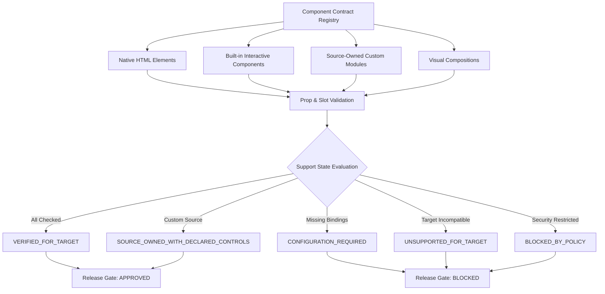

# ForgeStudio Architecture Blueprint: Point 08
# Component Contracts, Design Fidelity and Source Ownership

**Status:** IMPLEMENTED AND INTEGRATED  
**Controlling Blueprint:** `08 | Component contracts, design fidelity and source ownership`  
**Prerequisites:** Point 01–07 Authoritative Records, Generation Engine, Compiler Pipeline  
**Execution Ledger Version:** 2.4.0  

---

## 1. Executive Summary & Purpose

Point 08 establishes authoritative component governance, absolute design fidelity, hardened source import quarantine, and base-aware source synchronization across ForgeStudio:
- **Authoritative Versioned Component Contracts**: Explicit contract definitions for native elements, interactive widgets, visual compositions, and custom modules with strict prop/slot validation and preservation of intentional falsy values (`false`, `0`, `""`, `[]`, `null`).
- **Editor and Published Runtime Parity**: Shared component interpretation and rendering logic, with non-contaminating editor overlays completely stripped from visitor-facing production markup.
- **Design Fidelity & Style Preservation**: Exact preservation of custom breakpoints, CSS Grid, Flexbox, typography, spacing, pseudo-states (`:hover`, `:focus`), keyframe animations, container queries, and CSS custom variables without lossy utility-class degradation.
- **Explicit Component Support States**: States (`VERIFIED_FOR_TARGET`, `SOURCE_OWNED_WITH_DECLARED_CONTROLS`, `CONFIGURATION_REQUIRED`, `UNSUPPORTED_FOR_TARGET`, `BLOCKED_BY_POLICY`) preventing empty container substitution and blocking unverified release targets.
- **Safe Custom JSX/TSX Source Import**: Quarantined staged import with size/expansion limits, path traversal defenses, AST security inspection (detecting `child_process`, `eval`, `process.env`), and SBOM generation.
- **Preview Isolation & Network Egress Boundaries**: Distinct preview origin, restrictive iframe sandboxing (`allow-scripts`, no `allow-same-origin`), minimal CSP, strict `postMessage` protocol, and hardened SSRF boundary defenses (blocking loopback, private RFC1918, cloud metadata, dword/hex IPs).
- **Base-Aware Three-Way Source Reconciliation**: Tracking Generated Baseline, Current User Source, and New Generated Proposal. Automatically merges non-overlapping changes while detecting genuine conflicts, placing regeneration locks, and requiring explicit resolution.
- **Behavioral Review Release Gate**: Business logic changes (actions, authorization, data queries, payments) strictly mandate behavioral/contract test evidence; visual-only approvals cannot authorize behavioral modifications.

---

## 2. Component Contract Architecture



### Invariants:
1. **No Implicit Inference**: Variants, props, and slots are never inferred from component names.
2. **Explicit Defaults Preservation**: Intentional `false`, `0`, empty strings, empty arrays, and `null` are preserved verbatim.
3. **Target Compatibility**: Components specify allowed deployment targets (`SSR`, `SSG`, `CSR`, `WORDPRESS`, `NEXTJS`, `STATIC_HTML`). Incompatible targets transition to `UNSUPPORTED_FOR_TARGET` and block release.
4. **No Empty Container Substitution**: An unsupported or policy-blocked component is never silently converted into an empty container.

---

## 3. Editor Canvas & Published Runtime Parity

```
+-------------------------------------------------------------+
|                      Shared Core Markup                     |
|            <button class="btn btn-primary">Submit</button>  |
+------------------------------+------------------------------+
                               |
            +------------------+------------------+
            |                                     |
            v                                     v
+-----------------------+             +-----------------------+
|      Editor Mode      |             |    Production Mode    |
+-----------------------+             +-----------------------+
| Injects overlays:     |             | Strips all editor     |
| - data-forge-node-id  |             | attributes:           |
| - data-forge-selected |             | <button class="btn    |
| - resize handles      |             |  btn-primary">Submit  |
| - inspector markers   |             | </button>             |
+-----------------------+             +-----------------------+
```

- Automated parity test suites verify that `renderComponent(..., { mode: "PRODUCTION" })` produces zero leaked editor attributes and matches the semantic core of editor output.

---

## 4. Quarantined Custom Source Import Pipeline

1. **Quarantine Storage**: Received source is staged in isolated quarantine. Maximum file size (10 MB), entry count (100), and path depth (5) are strictly enforced.
2. **Path Traversal & Extension Rejection**: Rejects `..`, path separators in filenames, and dangerous binary/script extensions (`.exe`, `.sh`, `.bat`, `.dll`, `.vbs`).
3. **Cryptographic Provenance**: Computes SHA-256 of original uploaded bytes and records uploader ID, tenant ID, project ID, and declared license.
4. **AST Security Analysis**: Scans for dangerous capabilities:
   - Process execution (`child_process`, `cluster`)
   - Dynamic code execution (`eval()`, `new Function()`)
   - Environment and prototype manipulation (`process.env`, `__proto__`)
   - Remote URL dynamic imports (`import("http://...")`)
   - Lifecycle scripts (`postinstall`)
5. **SBOM & Dependency Closure**: Identifies external dependencies and generates structured Software Bill of Materials.

---

## 5. Preview Sandboxing & Network Boundaries

### Preview Isolation
- **Iframe Sandboxing**: Restrictive `sandbox="allow-scripts"` (explicitly omitting `allow-same-origin` and `allow-top-navigation`).
- **Content Security Policy**: Restricts execution to self-origin scripts and frames.
- **Strict postMessage Protocol**: Validates sender origin and allows only declared message types (`INIT`, `UPDATE_PROPS`, `MOUNT_CONFIRM`, `RUNTIME_ERROR`, `RESIZE`).
- **Zero Token Leakage**: Control-plane authentication tokens, cookies, and platform secrets are strictly prohibited from preview frames.

### Hardened SSRF Network Boundary
- Blocks IPv4 Loopback (`127.0.0.0/8`) and IPv6 Loopback (`::1`).
- Blocks Private RFC1918 subnets (`10.0.0.0/8`, `172.16.0.0/12`, `192.168.0.0/16`).
- Blocks Cloud Instance Metadata (`169.254.169.254`, `metadata.google.internal`).
- Blocks alternative numeric DWORD representations (e.g., `2130706433`), hex IPs, and octal notations.

---

## 6. Base-Aware Three-Way Source Reconciliation

ForgeStudio tracks three distinct representations for every synced source unit:
1. **Generated Baseline ($B$)**: Ancestor generated code version.
2. **Current User Source ($U$)**: Current file content including manual developer edits.
3. **New Generated Proposal ($P$)**: Candidate generated output from regeneration or AI patch.

```
       Generated Baseline (B)
             /       \
            /         \
User Edits (U)      Proposal (P)
            \         /
             \       /
        Three-Way Engine
             /       \
   Non-overlapping   Overlapping
         |                |
     Clean Merge       Conflict Record
     (Auto Apply)      (Lock Regeneration)
```

### Reconciliation Rules:
- **$U = B \land P \neq B$**: Generated-only change $\rightarrow$ Automatically applied.
- **$P = B \land U \neq B$**: User-only change $\rightarrow$ User edits strictly preserved.
- **$U \neq B \land P \neq B \land \text{non-overlapping}$**: Clean three-way merge.
- **$U \neq B \land P \neq B \land \text{overlapping}$**: Overlapping conflict $\rightarrow$ Locks regeneration for the affected file scope and records structured conflict.
- **Explicit Resolution API**: Developer chooses `KEEP_USER`, `ACCEPT_PROPOSAL`, or `CUSTOM_RESOLVED` to unlock regeneration.

---

## 7. Behavioral Review Gate for Business Logic Changes

Visual approval (e.g. screenshots or visual diffs) can ONLY authorize visual styling. It CANNOT authorize business logic mutations.
- **Detected Logic Categories**: `ACTION_DELIVERY` (forms, webhooks), `AUTHORIZATION_SECURITY` (roles, permissions), `DATA_ACCESS` (CMS queries, database calls), `PAYMENT_COMMERCE` (checkout, billing).
- **Mandatory Behavioral Tests**: Requires corresponding contract tests (`ContractTest_FormDelivery`, `ContractTest_PaymentCommerce`) with passing assertions.
- **Anti-Weakening Invariant**: Generation proposals cannot delete, skip, or weaken existing tests.
- **Gate Enforcement**: Missing or failing behavioral tests block verified release promotion.
