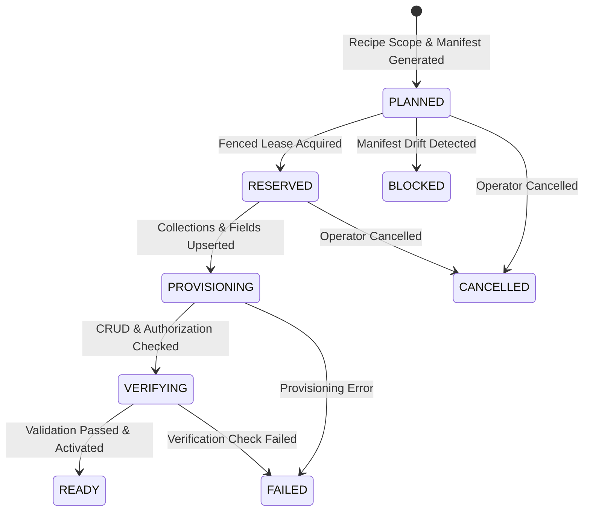

# ForgeStudio Architecture Blueprint: Point 09
# Automatic CMS and Blog Provisioning as a Complete Recipe

**Status:** IMPLEMENTED AND INTEGRATED  
**Controlling Blueprint:** `09 | Automatic CMS and blog provisioning as a complete recipe`  
**Prerequisites:** Point 01–08 Capabilities, Authoritative Records, Component Contracts  
**Execution Ledger Version:** 2.5.0  

---

## 1. Executive Summary & Purpose

Point 09 establishes an automated, end-to-end recipe provisioning engine for ForgeStudio that delivers a complete business capability—not just empty database tables—for eligible content-led and lead-generation websites:
- **Complete Versioned Recipe Manifest**: Generates deterministic provisioning manifests including collections, field schemas, public route bindings, navigation menus, owner administrative screens, and validation rules.
- **Durable 8-Step State Machine**: Manages the lifecycle through explicit legal states (`PLANNED`, `RESERVED`, `PROVISIONING`, `VERIFYING`, `READY`, `FAILED`, `BLOCKED`, `CANCELLED`).
- **Idempotency & Concurrency Governance**: Uniqueness on `(websiteId, recipeId, version)` and fenced worker leases eliminate duplicate jobs and stale worker commits.
- **Production Content Truthfulness**: Zero manufactured claims, testimonials, or fake metrics.
- **Industry-Specific Informational Collections**: Automatically provisions domain collections (`services`, `case-studies`, `courses`, `team`) tailored to the selected website profile.
- **Click-to-Edit Content Binding**: Maps preview DOM regions to stable `(collectionId, entryId, fieldKey)` coordinates, allowing direct in-place content updates without triggering layout regeneration.
- **Existing-Site Migration Previews**: Generates non-destructive collision and schema diff previews, keeping active releases untouched.

---

## 2. Provisioning Lifecycle State Machine



### 8-Step Execution Sequence:
1. `UNDERSTAND_SCOPE`: Resolves business brief, inventory, and confirmed facts.
2. `PLAN`: Computes versioned manifest, dependencies, and collision previews.
3. `RESERVE`: Acquires fenced worker lease and reserves unique resource identities.
4. `PROVISION_CONTENT`: Idempotently creates collections and typed field definitions.
5. `BIND_DESIGN`: Binds list, detail, and query templates with empty/loading/404 states.
6. `CONFIGURE_OWNER_UX`: Generates management screens, field controls, and validation rules.
7. `VERIFY`: Executes live CRUD checks, draft privacy, and route projections.
8. `ACTIVATE`: Marks recipe READY while leaving unconfigured external integrations inactive.

---

## 3. Automatic Defaults & Profile Collections

### Standard Defaults:
- **Blog Posts (`posts`)**: Title, slug, excerpt, content, featured image, author reference, category reference, tags, SEO metadata.
- **Authors (`authors`)**: Full name, slug, bio, avatar image, role.
- **Categories (`categories`)**: Category name, slug, description.

### Industry-Specific Informational Collections:
- `PROFESSIONAL_SERVICES` / `LOCAL_BUSINESS`: `services`, `case-studies`.
- `MEMBERSHIP_ACADEMY`: `courses` (informational catalog).
- Invariant: Informational catalogs are strictly decoupled from transactional engines (booking, LMS, pricing).

---

## 4. Click-to-Edit Content Architecture

Visual elements rendered on the canvas embed stable data coordinates:
```html
<h1 data-forge-content="col-posts:entry-123:title">Empowering Digital Commerce</h1>
```
- Clicking the element opens the targeted CMS field editor.
- Updates are classified as `CONTENT_CHANGE`:
  - Directly saves a new draft revision in Record 4.
  - Zero layout regeneration or component replacement.
  - Preserves underlying component contracts and source ownership.
