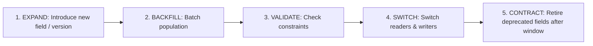

# ForgeStudio Architecture Blueprint: Point 10
# Content Model, Publishing and Preservation

**Status:** IMPLEMENTED AND INTEGRATED  
**Controlling Blueprint:** `10 | Content model, publishing and preservation`  
**Prerequisites:** Point 01–09 Authoritative Records, Recipe Engine, Release Gates  
**Execution Ledger Version:** 2.5.0  

---

## 1. Executive Summary & Purpose

Point 10 establishes content model governance, immutable revisions, scheduled publication, and protected-source preservation across ForgeStudio:
- **Separation of State Dimensions**: Distinct tracking of Editorial State (`DRAFT`, `IN_REVIEW`, `APPROVED`), Publication State (`UNPUBLISHED`, `PUBLISHED`, `SCHEDULED`), Deletion State (`ACTIVE`, `TRASHED`, `PURGED`), and Legal Holds (`boolean`).
- **Immutable Revision Lifecycle**: Editing published content creates an independent draft revision, leaving the active published revision untouched and publicly served.
- **Safe Schema Evolution**: Expand -> Backfill -> Validate -> Switch -> Contract lifecycle. Field renames preserve stable field identities without breaking bindings.
- **Scheduled Publication & UTC Timezone Correctness**: Scheduled execution instants are stored in UTC with editorial timezone preserved.
- **Immediate Unpublishing**: Authoritative layer immediately blocks public access upon unpublishing and triggers CDN cache invalidation.
- **Protected-Source Preservation**: Entries, drafts, and historical revisions are protected source—never pruned by age, generic cleanup, or ORM cascades.
- **Governed Purge & Audit Safeguards**: Soft-delete Trash vs. Permanent Purge. Purge requires independent expiring approval, exact manifest counts, and active legal-hold verification.
- **Non-Destructive Content Imports**: Dry-run previews and duplicate detection. Mandatory Invariant: Omitted rows NEVER delete existing records!
- **Coordinated Publication Manifest**: Extends Point 06 Record 6 by pinning exact revisions across content entries, schemas, layouts, menus, and component contracts.

---

## 2. Evolved Content Model & Revision Lifecycle

```
[Entry: entry-post-01]
  ├── Published Pointer ──> [Revision 1: Published Version] (Active Publicly)
  └── Current Draft ─────> [Revision 2: Editorial Draft]   (Private / Author Only)
```

### Invariants:
1. **Public Projection Isolation**: Public APIs and retrieval queries project ONLY `publishedRevisionId` where `deletionState === "ACTIVE"`. Drafts, private fields, and trashed entries never leak.
2. **Atomic Publication**: Publishing Draft 2 updates `publishedRevisionId` atomically to Revision 2. Revision 1 remains preserved in historical revisions for instant rollback.

---

## 3. Schema Evolution Lifecycle



- **Field Rename**: Modifies display label while preserving stable `fieldId` and `key`, ensuring visual templates and component bindings continue functioning without interruption.

---

## 4. Protected Source & Governed Purge

| Operation | Privileges Required | Effect | Undoable? |
| :--- | :--- | :--- | :--- |
| **TRASH** | Author / Editor | Sets `deletionState = "TRASHED"`, unpublishes item, records audit reason. | Yes (`RESTORE` defaults to unpublished) |
| **RESTORE** | Editor / Admin | Sets `deletionState = "ACTIVE"`, validates slug uniqueness, defaults unpublished. | N/A |
| **PURGE** | `PLATFORM_POLICY_OWNER` | Requires independent expiring approval, validates zero legal holds, purges records. | Permanent |

- Content entries and historical revisions are protected source: background database vacuuming or ORM cascades are strictly forbidden from deleting them.

---

## 5. Coordinated Publication Manifest

Extending Point 06 Record 6:
```json
{
  "manifestId": "coord-man-site-123-1728740000",
  "siteSpecRevision": 3,
  "contentRevisionIds": {
    "entry-post-01": "rev-entry-post-01-2",
    "entry-post-02": "rev-entry-post-02-1"
  },
  "schemaVersions": {
    "col-posts": 2
  },
  "componentContractHashes": {
    "HeroSection": "a1b2c3..."
  },
  "manifestChecksum": "e4f5g6..."
}
```
- Guarantees that layouts are never published with incompatible content schema revisions.
