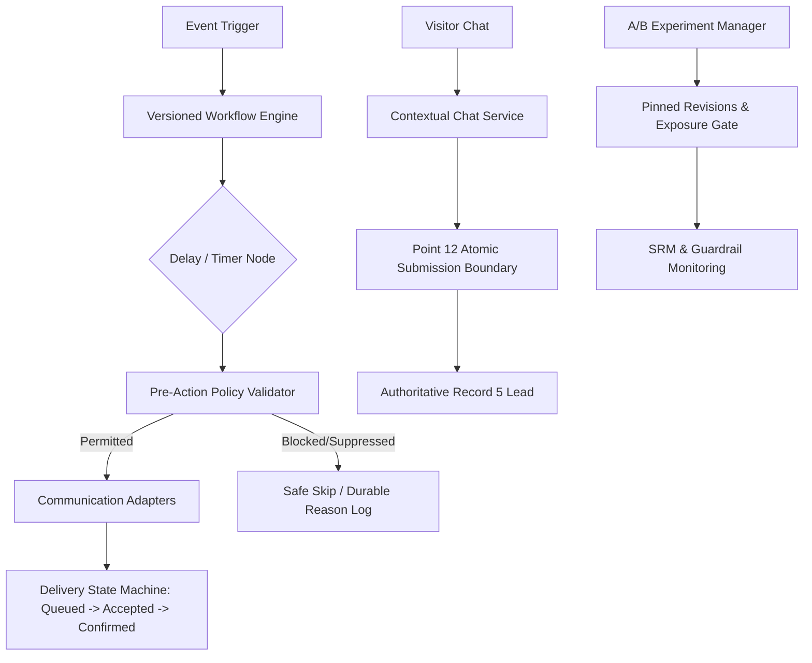

# 15. Workflows, Communication, Experiments and Contextual Chat

**Document Version:** 1.0.0  
**Blueprint Reference:** Point 15 — Workflows, communication, experiments and contextual chat  
**Repository:** `navinray12/forgestudio-ai`

---

## 1. Executive Architecture Summary

Point 15 unifies multi-channel workflow automation, policy revalidation, transactional/marketing communication separation, explainable contact scoring, disciplined A/B experimentation, and privacy-preserving contextual chat into the authoritative ForgeStudio platform.

### Core Invariants:
1. **Immutable Published Workflows:** Editing a published workflow creates an unpromoted draft. Once published, execution graph versions are frozen.
2. **Pre-Action Policy Revalidation:** Conditions are authoritatively checked immediately before consequential side-effects, accounting for quiet hours, suppressions, consent changes, and budget limits.
3. **Simulation Isolation:** Workflow dry-runs and simulations run with synthetic recipients and virtual clocks without sending real external emails/SMS or modifying production leads.
4. **Honest Delivery Receipts:** Acceptance by a provider API is never claimed as confirmed inbox delivery.
5. **No Resubscription on Import:** Contact imports cannot override existing suppression/unsubscribe entries.
6. **Unbiased Lead Scoring:** Refused analytics consent or missing tracking is classified as `UNKNOWN_NOT_COLLECTED`, never penalized as low buyer interest.
7. **Experimentation Integrity:** Control and treatment revisions are pinned; assignment is tracked separately from exposure; sample-ratio mismatch (SRM) invalidates trials.
8. **Context-Minimizing Chat:** Chatbots receive task-relevant content only, excluding raw IPs, exact coordinates, and ad click identifiers. Conversational mentions do not create leads without explicit user confirmation.

---

## 2. Component Structure & Data Flow

---

## 3. Detailed Service Specifications

### 3.1 Versioned Workflow Automation Engine (`workflowEngine.service.ts`)
- Graph validation checks for graph cycles, unreachable nodes, and missing exits.
- Concurrency and leased workers: Monotonic fencing tokens ensure stale worker instances cannot execute expired or superseded execution steps.
- Simulation engine: Evaluates DAG traversal using virtual time increments and synthetic identities (`synthetic-lead@forgestudio.simulation.local`).

### 3.2 Pre-Action Policy Validator (`preActionPolicyValidator.service.ts`)
- Rechecks tenant identity, active lead state, channel permission, unsubscribe status, quiet hours (21:00-08:00 in recipient local time), frequency caps (max 3/day for marketing), and remaining workflow budget immediately prior to dispatch.

### 3.3 Communication Adapters (`communicationAdapters.service.ts`)
- Supports Email, SMS, WhatsApp, Telegram, and Voice.
- Enforces strict delivery states: `QUEUED`, `ACCEPTED_BY_PROVIDER`, `DELIVERED`, `BOUNCED`, `COMPLAINED`, `SUPPRESSED`, `FAILED`, `RETRYABLE`, `TERMINAL_FAILURE`.
- Webhook callbacks update delivery status and automatically synchronize suppressions.
- Contact imports safely partition eligible records and skip previously suppressed emails/phones.

### 3.4 Explainable Scoring & Segmentation (`explainableScoringSegmentation.service.ts`)
- Generates point breakdowns based on first-party form submissions, corporate domains, and verified phones.
- Implements repeat-action caps to prevent spamming from skewing scores.
- Uncollected tracking data due to consent refusal is recorded without penalty.
- Bounded queries prevent database denial-of-service.

### 3.5 Experimentation Engine (`experimentationEngine.service.ts`)
- Pins exact revisions for Control and Treatment variants.
- Separates visitor assignment from verified viewport exposure.
- Computes Chi-square sample-ratio mismatch (SRM) and marks experiments `INVALID` upon statistical contamination.
- Enforces automatic safety stops if treatment conversion falls below the safety floor.

### 3.6 Contextual Chat Service (`contextualChatService.service.ts`)
- Enforces context minimization: no raw IPs, exact coordinates, or ad tracking IDs.
- Location requires explicit user permission.
- Authoritatively filters knowledge retrieval: only `PUBLISHED` content from the same tenant can be retrieved; drafts and trashed content are never exposed.
- Tool invocation runs strictly outside the model with schema validation.
- Lead capture delegates directly to Point 12's `AtomicSubmissionBoundary`.
