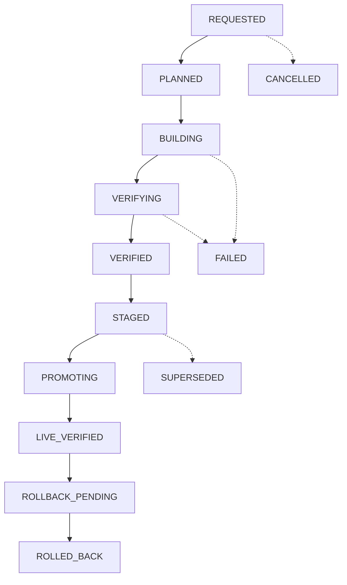

# 17. Release Integrity, Evidence and Change Safety

**Document Version:** 1.0.0  
**Blueprint Reference:** Point 17 — Release integrity, evidence and change safety  
**Repository:** `navinray12/forgestudio-ai`

---

## 1. Executive Architecture Summary

Point 17 defines the authoritative durable release controller, 8-state release lifecycle, immutable candidate artifacts, cryptographic release passport with trusted verifier attestations, 12 mandatory release gates with full regression floors, and safe code-only rollback that preserves newly committed business transactions and leads.

### Core Invariants:
1. **Immutable Candidate Artifacts:** Preview, download, staging, and promotion must reference the exact same artifact digest. Re-generating code after verification and claiming it is the approved release is strictly prohibited.
2. **Compare-And-Swap (CAS) Active Pointer:** Promotion uses CAS on the active release pointer. Stale worker leases are rejected using monotonic fencing tokens.
3. **No Self-Issued Attestations:** Customer-controlled build scripts cannot sign release attestations or access verification keys.
4. **Non-Waivable Security Gates:** Gate 06 (Authorization, Tenant Isolation, and Privacy) can never be waived through an exception.
5. **Separation of Recovery Operations:** Visual or code rollbacks never restore database backups or drop tables, preserving all newly accepted leads and business transactions.

---

## 2. Release State Machine

---

## 3. The 12 Mandatory Release Gates

1. **GATE_01_SPEC_COMPLETENESS:** Specification Completeness and Target Support
2. **GATE_02_TYPE_CHECK_DEPS:** Type Checking, Imports and Dependency Resolution
3. **GATE_03_REPRODUCIBLE_BUILD:** Clean Reproducible Build
4. **GATE_04_SOURCE_PRESERVATION:** Source Preservation and Protected-File Checks
5. **GATE_05_CONTENT_DB_MIGRATION:** Real Content, Database and Migration Behavior
6. **GATE_06_AUTH_TENANT_PRIVACY:** Authorization, Tenant Isolation and Privacy *(NON-WAIVABLE)*
7. **GATE_07_FUNCTIONAL_JOURNEYS:** Functional Browser Journeys
8. **GATE_08_ACCESSIBILITY:** Accessibility Standards
9. **GATE_09_ROUTES_SEO_STATUS:** Routes, HTTP Statuses and SEO Behavior
10. **GATE_10_PERFORMANCE_BUDGET:** Performance Budgets and Payload Limits
11. **GATE_11_STAGING_DEST_PROBES:** Staging and Deployed Destination Probes
12. **GATE_12_EXPORT_COMPATIBILITY:** Export and Runtime Compatibility

---

## 4. Services Overview

### 4.1 Durable Release Controller (`durableReleaseController.service.ts`)
- Manages legal state transitions, worker fencing tokens, and CAS promotions.
- Performs code-only rollback while preserving Record 5 leads and Postgres database data.

### 4.2 Release Passport Service (`releasePassportService.service.ts`)
- Issues HMAC-SHA256 signed release passports binding exact artifact digests and gate attestations.
- Rejects customer build scripts attempting to self-issue attestations.

### 4.3 Mandatory Release Gates Service (`mandatoryReleaseGates.service.ts`)
- Evaluates the 12 gates against full regression floors.
- Prohibits exceptions for security/privacy gate 06.
- Executes staging probes checking homepage, assets, canonical routes, forms, and draft isolation.
