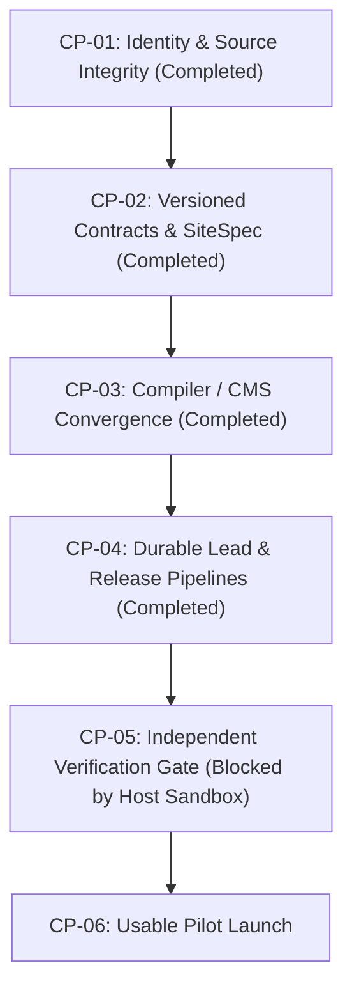

# Point 24 — Delivery Stages and Realistic Planning

**Authoritative Reference:** Blueprint Point 24  
**Status:** `IMPLEMENTED — UNVERIFIED` (Host subprocess sandbox restriction blocks live test execution)  
**Verification Date:** 2026-10-12  

---

## 1. Executive Summary & Delivery Principles

Point 24 establishes an evidence-based, role-accountable planning methodology for ForgeStudio. In strict accordance with platform truthfulness invariants:
1. **Planning Scenarios are Not Guarantees:** Delivery durations are planning scenarios based on measured complexity, not contractual launch dates.
2. **Anti-Overclaiming Gate:** Release candidates cannot claim comprehensive Blueprint v1.3 coverage unless all mandatory gates, tests, and capabilities are qualified.
3. **Critical Path Dependency Graph:** Hard dependencies must complete before dependent work can be promoted. Cycle detection, duplicate ID detection, and prerequisite completion order are strictly enforced.
4. **Dynamic Evidence-Based Status:** Stage completion status derives dynamically from evidence records (e.g. `CAP-001` in `EvidenceRegistry`), never from static configuration assumptions.

---

## 2. 4 Delivery Stages

| Stage | Planning Assumption | Duration (Weeks) | Required Exit Evidence |
|---|---|---|---|
| **Stage 1: Foundation Assessment** | Initial repository audit, defect reproduction, baseline architecture validation | ~2 weeks | Reproducible defects cataloged, reusable components audited, test environment mapped, critical path established. |
| **Stage 2: Controlled Website Pilot** | Qualified website/CMS/blog/forms subset, core safety, managed publication | 12–16 weeks | Deterministic compiler, atomic form submissions, durable lead capture, non-destructive CPT saves, clean-host portable profile verified. |
| **Stage 3: Comprehensive Growth Platform** | All applicable growth capabilities, provider evidence, WordPress & agency operations | 6–9 months | Attribution engine with fail-closed consent, A/B testing with SRM checks, contextual chat, WordPress bidirectional sync, agency delegation. |
| **Stage 4: Industry & Enterprise Expansion** | Selected industry lifecycles (bookings, e-commerce), enterprise multi-tenant isolation | 6+ months | Transactional booking & inventory, financial auditability, proven database/media disaster recovery restores, independent security audit. |

---

## 3. Critical Path Dependency Graph

- **Graph Invariant:** Rejects cycles, duplicate node IDs, and nodes marked completed before their prerequisites are fulfilled.

---

## 4. Release-Scope Labels & Anti-Overclaiming Rules

| Release Scope Label | Minimum Passed Gates | Allowed Claims | Prohibited Claims | Authoritative CAPs Required |
|---|---|---|---|---|
| `INTERNAL_DEV_BUILD` | 2 | Internal engineering iteration | Production ready, commercial reliability | None |
| `UNVERIFIED_PREVIEW` | 4 | Visual preview, ephemeral staging | Durable storage, production publication | `CAP-001`, `CAP-002` |
| `CONTROLLED_PILOT` | 8 | Controlled business pilot, standard CMS & leads | Full enterprise multi-region, untrusted code | `CAP-001`..`CAP-006` |
| `VERIFIED_BUSINESS_SITE_PROFILE` | 10 | Production business website, Core Web Vitals | Arbitrary server code, live ads automation | `CAP-001`..`CAP-006`, `CAP-008` |
| `QUALIFIED_PORTABLE_PROFILE` | 11 | Self-hosted Docker Compose, zero lock-in | Automatic cloud backup without config | `CAP-001`, `CAP-002`, `CAP-008`, `CAP-016` |
| `QUALIFIED_WORDPRESS_LOCAL_PROFILE` | 10 | Local WordPress export, WP headless integration | Two-way arbitrary PHP plugin execution in cloud | `CAP-001`, `CAP-002`, `CAP-016` |
| `COMPREHENSIVE_GROWTH_PROFILE` | 12 | Full Blueprint v1.3 SaaS coverage, marketing attribution | (None, once all 12 gates pass) | `CAP-001`..`CAP-018` |

- **Authoritative Validation:** Claims are verified against `CapabilityRegistry.getCapabilityById()`. Any missing, unverified, or blocked mandatory capability rejects promotion.

---

## 5. Verification & Acceptance Tests

- Test suite: `backend/src/tests/point24-delivery-stages.test.ts`.
- Validates: non-commitment invariant across all 4 stages, DAG validity, cycle detection, duplicate rejection, and capability-checked anti-overclaiming enforcement.
