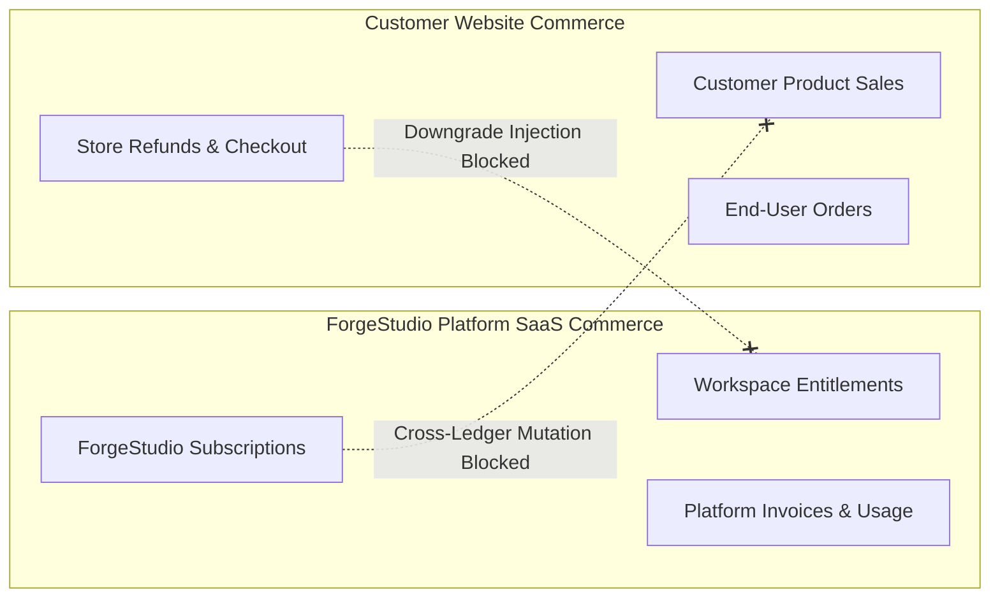

# Point 26 — Commercial Product, Agency Operation and Support

**Authoritative Reference:** Blueprint Point 26  
**Status:** `IMPLEMENTED — UNVERIFIED` (Host subprocess sandbox restriction blocks live test execution)  
**Verification Date:** 2026-10-12  

---

## 1. Commercial Domain Separation

Point 26 enforces strict physical and logical boundaries between two distinct commerce domains:

- **Invariant:** A platform payment webhook can never record a customer store sale.
- **Invariant:** A customer store refund can never alter ForgeStudio subscription entitlements.
- **Idempotency & Replay:** Webhook dispatches validate idempotency keys and enforce a 10-minute timestamp tolerance window.

---

## 2. Workspace Ownership Transfer & Orphan Prevention

- **Token Generation:** Generated using `crypto.randomBytes(32)` (256-bit high-entropy cryptographically secure random token, never a predictable timestamp hash).
- **Storage:** Only the SHA-256 hash of the token is stored; plaintext tokens are never persisted.
- **Concurrency Fencing:** Only one pending transfer can be active per website at any time. Simultaneous transfer requests on the same site are rejected.
- **Timing-Safe Comparison:** Target acceptance uses `crypto.timingSafeEqual` against stored token hash.
- **Safe Rollback / Orphan Prevention:** If target provisioning fails, website ownership automatically reverts (`FAILED_ROLLED_BACK`) to the originating owner. A site is never left orphaned without an authorized owner.

---

## 3. Template & Recipe Governance

- Shared templates are versioned with immutable provenance and licensing metadata.
- **Mandatory Opt-In:** Template updates generate an impact report detailing breaking changes and affected site counts. They **never** silently overwrite existing customer sites.

---

## 4. Past-Due Account Lifecycle (Zero Data Destruction)

- **Grace Period (Days 1–14):** Full read access, source code export, and new publishing enabled with payment reminder notifications.
- **Post-Grace Period (Day 15+):** New publishing restricted; **Read access and Source Code Export remain permanently active** to honor customer data portability rights.
- **Strict Invariant:** Customer blogs, source code, leads, or media assets are **never unexpectedly purged or destroyed** to enforce a subscription limit.

---

## 5. Verification & Acceptance Tests

- Test suite: `backend/src/tests/point26-commercial-agency-support.test.ts`.
- Validates: cross-ledger webhook isolation, idempotency, 256-bit secure transfer token generation, concurrency fencing, ownership transfer rollback, mandatory opt-in template upgrades, and non-destructive past-due lifecycles.
