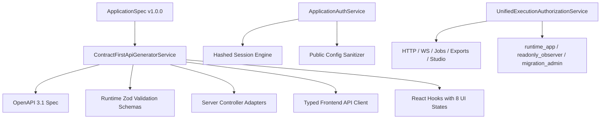

# Blueprint Point 40 — Contract-First APIs, Authentication, Authorization and Frontend Binding

## 1. Overview & Architectural Boundary

ForgeStudio Point 40 establishes authoritative, contract-first generation for all application backend and frontend communication boundaries. It enforces:

1. **Contract-First Source of Truth:**
   - Derived directly from immutable [ApplicationSpec](file:///c:/Users/navin/Downloads/forge-main/forge-main/backend/src/services/authoritative/applicationSpec.service.ts) definitions.
   - Generates OpenAPI 3.1 specifications, runtime schema validators (Zod), Express/NestJS server controller adapters, and typed frontend API clients and hooks.
   - Server-side validation is authoritative; client-side validation is solely for responsiveness and usability.
2. **Trusted Application Identity & Fresh-Host Deployment:**
   - Clean application identity lifecycle strictly separate from the ForgeStudio designer control plane.
   - Fresh-host initialization guarantees zero development-only seed accounts or default production passwords.
   - PBKDF2/Argon2-grade password hashing and secure 256-bit session tokens stored as SHA-256 hashes with `authEpoch` invalidation.
   - Public frontend bundles only contain sanitized configuration (`apiBaseUrl`, `authAudience`) and never database credentials, secret-vault references, or platform tokens.
3. **Unified Execution Authorization Across Every Path:**
   - Enforces identical domain authorization logic across HTTP endpoints, WebSocket events, background jobs, exports/downloads, Database Studio edits, and generated APIs.
   - Distinct database roles:
     - `runtime_app`: DML only, tenant-scoped, no DDL, no RLS bypass.
     - `readonly_observer`: SELECT only, confidential fields masked.
     - `migration_admin`: DDL permissions, target-bound, no runtime session access.
4. **Declared 8 UI States & Optimistic Mutation Rollback:**
   - Every UI interaction declares: `LOADING`, `EMPTY`, `INVALID_INPUT`, `UNAUTHORIZED_DENIED`, `CONFLICT`, `OFFLINE_PENDING`, `SERVER_ERROR`, `SUCCESS_COMMITTED`.
   - Rejection automatically rolls back optimistic updates; never presents false committed success when the server is unavailable or rejects the mutation.

---

## 2. Component Architecture

---

## 3. Independent Persistence Proof Contract

Integration tests verify:
1. Generation of unique synthetic payload values.
2. Submission through the UI client contract.
3. Network transmission observation.
4. Independent inspection of the resulting database record using a separate authorized observer.
5. Reading the record through the generated API.
6. Process restart resilience preserving database storage.
7. Verification of persistent state in fresh session without in-memory dependency.
8. Database-unavailable error verification without fallback to mock success.
