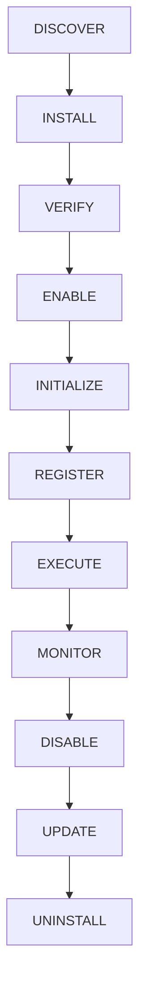

# Forge Extension & Plugin SDK Guide

The **Forge Extension & Plugin SDK** enables developers and organizations to build, verify, package, and distribute custom capabilities for ForgeStudio.

---

## 1. Extension Lifecycle

Every Forge extension transitions through a deterministic, 11-stage lifecycle:



1. **DISCOVER**: Query available extensions from trusted marketplace registries or private organization catalogs.
2. **INSTALL**: Download asset bundle, verify cryptographic digest, and unpack into workspace extension staging directory.
3. **VERIFY**: Perform schema validation against `PluginManifestSchema` and assess requested capability permissions.
4. **ENABLE**: Transition state to `ENABLED` and record publisher trust score.
5. **INITIALIZE**: Allocate isolated execution context and register sandboxed hook listeners.
6. **REGISTER**: Expose commands, UI panels, context menus, and AI tool endpoints to Developer Workspace.
7. **EXECUTE**: Run extension hooks or AI tools within strict memory and timeout boundaries (default: 30,000ms).
8. **MONITOR**: Track execution duration, failure rates, and resource utilization in Developer Observability.
9. **DISABLE**: Safely unbind hook listeners without disturbing persistent filesystem data.
10. **UPDATE**: Non-destructively apply new version manifests while preserving user configuration.
11. **UNINSTALL**: Cleanly purge extension data and revoke capability permissions.

---

## 2. Plugin Manifest Specification (`forge.plugin.json`)

Extensions must include a validated manifest adhering to `PluginManifestSchema`:

```json
{
  "$schema": "https://forge.live/schemas/plugin-manifest-v1.json",
  "manifestVersion": "1.0.0",
  "id": "forge-plugin-code-linter",
  "name": "Smart Code Linter",
  "version": "1.2.0",
  "description": "Deterministic AST linting and security vulnerability scanning",
  "author": {
    "name": "Forge Platform Team",
    "email": "plugins@forge.live",
    "url": "https://forge.live",
    "verified": true
  },
  "compatibility": {
    "minForgeVersion": "2.0.0",
    "engines": {
      "node": ">=18.0.0"
    }
  },
  "permissions": [
    "filesystem.read",
    "ai.tool"
  ],
  "lifecycle": {
    "canDisable": true,
    "canUninstall": true,
    "isolatedExecution": true
  },
  "hooks": {
    "preBuild": "bin/pre-build.js",
    "postBuild": "bin/post-build.js"
  },
  "aiTools": [
    {
      "name": "lintSourceCode",
      "description": "Performs static code analysis and returns structured diagnostics",
      "parameters": {
        "type": "object",
        "properties": {
          "filePath": { "type": "string" },
          "fix": { "type": "boolean" }
        },
        "required": ["filePath"]
      }
    }
  ],
  "commands": [
    {
      "id": "linter.runWorkspaceScan",
      "title": "Run Full Workspace Lint",
      "category": "Code Quality"
    }
  ],
  "panels": [
    {
      "id": "linter.resultsView",
      "title": "Lint Diagnostics",
      "location": "bottomDrawer"
    }
  ]
}
```

---

## 3. Capability-Based Permissions (Least Privilege)

Forge strictly enforces least-privilege capability permissions. Extensions can only request granular scopes:

| Permission | Description |
| :--- | :--- |
| `filesystem.read` | Read non-protected files within the project workspace |
| `filesystem.write` | Create or update files within the project workspace |
| `terminal.execute` | Execute approved commands in the terminal sandbox |
| `network.request` | Make outbound HTTP requests to whitelisted domains |
| `database.read` | Read project database schemas and tables |
| `database.write` | Execute data mutations against project database |
| `git.read` | Inspect Git branches, history, and diffs |
| `git.write` | Stage files and create local commits |
| `deployment.read` | Inspect preview and production deployment statuses |
| `deployment.write` | Trigger preview environment builds |
| `ai.tool` | Register callable tools for AI Coding and Architecture Agents |
| `project.read` | Query project metadata and manifest properties |
| `project.write` | Update project configuration and settings |

---

## 4. Registering AI Tools & Generators

Extensions can provide custom AI tools that the Forge AI Multi-Agent Orchestrator can invoke autonomously:

```typescript
import { defineForgePlugin } from "@forge/plugin-sdk";

export default defineForgePlugin({
  manifest: "./forge.plugin.json",
  async onExecuteAiTool(toolName, params, context) {
    if (toolName === "lintSourceCode") {
      const file = await context.filesystem.readFile(params.filePath);
      const diagnostics = analyzeCode(file.content);
      return { diagnostics, clean: diagnostics.length === 0 };
    }
    throw new Error(`Unknown AI tool: ${toolName}`);
  },
});
```

---

## 5. Testing & Publishing

### Local Testing with the Forge CLI
```bash
# Validate manifest schema and permissions
forge plugin validate ./forge.plugin.json

# Test in current project workspace
forge plugin install --local ./
forge plugin list
forge plugin enable forge-plugin-code-linter
```

### Publishing to Private / Internal Registries
```bash
# Package extension bundle (.fpkg)
forge plugin package

# Sign package with developer key
forge plugin sign --key ./certs/publisher-key.pem

# Publish to workspace registry
forge plugin publish --registry https://registry.internal.forge.live
```
