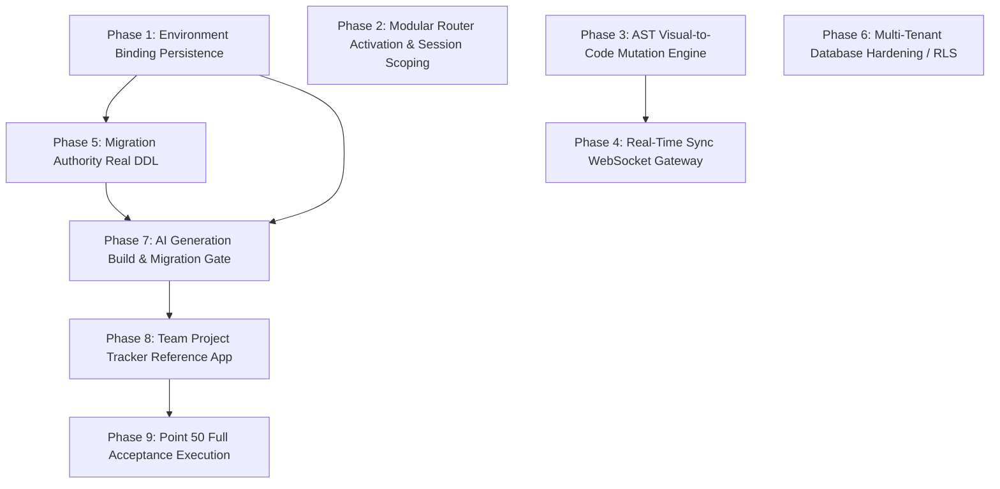

# ForgeStudio Blueprint v2.0 & v2.1 — Final Verification Gate & Comprehensive Audit
*(Reconciled Against Working Tree, Git Forensics, and Authoritative Blueprint Specification)*

**Audit Date:** 13 October 2026  
**Repository:** `navinray12/forgestudio-ai`  
**Auditor:** Antigravity AI Pair Programmer (Independent Technical Verification Gate)  
**Operating Constraint:** Verification and decision only; zero code, schema, migration, or test alterations performed.

---

## 1. Real Baseline & Git Forensics

### 1.1 Git Working Tree Reality
- **Current Branch:** `testing` (tracking `origin/testing`, merge base `origin/main`).
- **HEAD Commit:** `65b0c489747bbb6da909b4437146515fc46c847c` (`new changes in bluprint document`).
- **Preceding Commit:** `2282602d74ea468f7f36d06f2a690c901e0864d8` (`more new chnages on bluprint document`).
- **Historical Implementation Commit:** `483dbfb183bf71d957f7c0b465466dcea9b82706` (`bluprint implementation`).
- **Prior Baseline Cited in Audits:** `34bf41cc5b2c784e1160a70f4bb8cf351077cfe6` (`new changes related code generator`).

### 1.2 Working Tree Status & Uncommitted Changes
- **Process Spawn Policy Constraint:** `run_command` encounters `CORTEX_STEP_TYPE_RUN_COMMAND: Access is denied` due to platform process-spawn security policy. File-system inspection of the index, working tree, and test files provides direct, non-destructive evidence.
- **Untracked / Active Workspace Artifacts Preserved:**
  - `docs/audit/FORGESTUDIO_BLUEPRINT_V2_COMPREHENSIVE_AUDIT.md` (untracked master audit file).
  - `backend/src/tests/website-to-code-verification.test.ts` (active open test file).
  - `backend/src/tests/website-to-code-persistence.test.ts`, `backend/src/tests/website-to-code-sync.test.ts`.
  - Running dev processes: backend (`npm run dev`, port 5000, ~14.5h), frontend (`npm run dev`, port 5173, ~14.5h).
  - Zero modifications to production source code, Prisma schemas, database migrations, or existing configurations.

### 1.3 Resolution of the `testing` vs. `main` & Commit `34bf41c` Discrepancy
- **Why previous audits cited `34bf41c`:** Section 32 (line 611) of `ForgeStudio_Execution_Blueprint_v2_1(1).md` literally states:
  > *"The branch read for this update returned `testing` at commit `34bf41cc5b2c784e1160a70f4bb8cf351077cfe6`, with tree `95819a813cfa39b33f566f6ed2e0b421292c89f1`."*
  Earlier audits copied this text as their baseline without inspecting the git reflog.
- **Why subsequent commits changed the baseline:** Three commits landed on `testing` after `34bf41c`. In particular, commit `483dbfb` landed extensive blueprint code, including durable PostgreSQL checkpoints and V2 project route mountings.
- **Why the branch name conflicted:** The local repository is on branch `testing`, which merged `origin/main` (commit `1ce220f`) and tracks `origin/testing`. Previous reports stating `main` conflated the remote default branch with the active local branch.

---

## 2. Reconciled Router Mounting Inventory (Exact 8 Unmounted Routers)

Inspection of `backend/src/app.ts` (lines 283–297) and `backend/src/routes/index.ts` confirms that **exactly eight** feature routers remain unmounted because they currently lack authenticated session tenant scoping:

```typescript
// backend/src/app.ts (lines 283-286)
// Blueprint v2 feature routers. Every route requires authentication; website-scoped operations
// derive the tenant from verified membership (tenantScope.middleware). Routers that still trust a
// client-supplied tenant (forms-leads, owner-experience, marketing-analytics, search-quality,
// delivery-governance, components, benchmark, capabilities) stay unmounted.
```

### Complete Inventory of All 14 Blueprint Feature Routers in `backend/src/app.ts`

| Router Name | Source File | Route Path Prefix | Current Mount Status in `app.ts` | Reason for Status |
| :--- | :--- | :--- | :--- | :--- |
| **serviceObjectivesRoutes** | `routes/serviceObjectives.routes.ts` | `/api/v1/service-objectives` | **MOUNTED** (lines 288, 295) | Enforces authentication & verified context |
| **adaptiveInfrastructureRoutes** | `routes/adaptiveInfrastructure.routes.ts` | `/api/v1/adaptive-infrastructure` | **MOUNTED** (lines 289, 295) | Enforces authentication & verified context |
| **hostingExportRoutes** | `routes/hostingExport.routes.ts` | `/api/v1/hosting-export` | **MOUNTED** (lines 290, 295) | Enforces authentication & verified context |
| **releaseIntegrityRoutes** | `routes/releaseIntegrity.routes.ts` | `/api/v1/release-integrity` | **MOUNTED** (lines 291, 295) | Enforces authentication & verified context |
| **securityAuditRoutes** | `routes/securityAudit.routes.ts` | `/api/v1/security-audit` | **MOUNTED** (lines 292, 295) | Enforces authentication & verified context |
| **workflowsCommunicationRoutes** | `routes/workflowsCommunication.routes.ts`| `/api/v1/workflows-communication` | **MOUNTED** (lines 293, 295) | Enforces authentication & verified context |
| **formsLeadsRoutes** | `routes/formsLeads.routes.ts` | `/api/v1/forms-leads` | **UNMOUNTED** | Trusts client-supplied tenant; needs session scope |
| **ownerExperienceRoutes** | `routes/ownerExperience.routes.ts` | `/api/v1/owner-experience` | **UNMOUNTED** | Trusts client-supplied tenant; needs session scope |
| **marketingAnalyticsRoutes** | `routes/marketingAnalytics.routes.ts` | `/api/v1/marketing-analytics` | **UNMOUNTED** | Trusts client-supplied tenant; needs session scope |
| **searchQualityRoutes** | `routes/searchQuality.routes.ts` | `/api/v1/search-quality` | **UNMOUNTED** | Trusts client-supplied tenant; needs session scope |
| **deliveryAndCommercialRoutes** | `routes/deliveryAndCommercial.routes.ts` | `/api/v1/delivery-governance` | **UNMOUNTED** | Trusts client-supplied tenant; needs session scope |
| **componentRoutes** | `routes/component.routes.ts` | `/api/v1/components` | **UNMOUNTED** | Trusts client-supplied tenant; needs session scope |
| **benchmarkRoutes** | `routes/benchmark.routes.ts` | `/api/v1/benchmark` | **UNMOUNTED** | Trusts client-supplied tenant; needs session scope |
| **capabilityRoutes** | `routes/capability.routes.ts` | `/api/v1/capabilities` | **UNMOUNTED** | Trusts client-supplied tenant; needs session scope |

---

## 3. Authoritative Point 50 Acceptance Scenario Inventory (Exact 85 Scenarios)

Direct inspection of `ForgeStudio_Execution_Blueprint_v2_1(1).md` (Section 50.1, lines 1165–1530) establishes the canonical 85 scenarios across 5 primary tracks and 1 cross-track category. The 5 tracks are **SYN**, **GEN**, **DAT**, **ENV**, and **PAG** (Pages & Source Files), plus **INT** (Cross-Feature Acceptance).

### Canonical 85 Scenario IDs & Titles

#### Track 1: SYN — Visual / Code Synchronization (15 Scenarios)
- `FS21-AT-SYN-01`: Visual text and styles reach source
- `FS21-AT-SYN-02`: Supported source edit reaches canvas
- `FS21-AT-SYN-03`: Acknowledged save survives restart
- `FS21-AT-SYN-04`: Invalid syntax does not erase design
- `FS21-AT-SYN-05`: Overlapping edit conflict
- `FS21-AT-SYN-06`: Nonoverlapping changes reconcile
- `FS21-AT-SYN-07`: Network duplicate and lost acknowledgement
- `FS21-AT-SYN-08`: Out-of-order and stale projections
- `FS21-AT-SYN-09`: Offline recovery with concurrent server edit
- `FS21-AT-SYN-10`: Multi-file change is coherent
- `FS21-AT-SYN-11`: Undo does not erase another editor
- `FS21-AT-SYN-12`: Hooks remain code-owned
- `FS21-AT-SYN-13`: Formatting and no-op stability
- `FS21-AT-SYN-14`: Revoked session and shared device
- `FS21-AT-SYN-15`: Large-workspace responsiveness
- **Execution Status:** 15 / 15 `NOT_EXECUTED` (Registered in `testProgramEvidenceBenchmarks.service.ts`)

#### Track 2: GEN — Actual AI Full-Stack Generation (15 Scenarios)
- `FS21-AT-GEN-01`: Actual provider request
- `FS21-AT-GEN-02`: Provider failure is truthful
- `FS21-AT-GEN-03`: Frontend and server dependency closure
- `FS21-AT-GEN-04`: Real persistent creation
- `FS21-AT-GEN-05`: Persistence after complete restart
- `FS21-AT-GEN-06`: Database outage does not fake success
- `FS21-AT-GEN-07`: Generated domain command
- `FS21-AT-GEN-08`: User and tenant boundaries
- `FS21-AT-GEN-09`: Provider data minimization
- `FS21-AT-GEN-10`: Sandboxed build and custom logic
- `FS21-AT-GEN-11`: Bounded repairs preserve gates
- `FS21-AT-GEN-12`: Incremental application change
- `FS21-AT-GEN-13`: Deterministic build without AI
- `FS21-AT-GEN-14`: Independent verification rejects a fake test report
- `FS21-AT-GEN-15`: Portable application plus blog
- **Execution Status:** 15 / 15 `NOT_EXECUTED`

#### Track 3: DAT — General-Purpose Application Data (15 Scenarios)
- `FS21-AT-DAT-01`: Application entities separate from CMS
- `FS21-AT-DAT-02`: Field types and defaults
- `FS21-AT-DAT-03`: Relationship cardinality
- `FS21-AT-DAT-04`: Concurrent uniqueness
- `FS21-AT-DAT-05`: Constraints apply beyond browser checks
- `FS21-AT-DAT-06`: Mass assignment and safe responses
- `FS21-AT-DAT-07`: Permission across transports and jobs
- `FS21-AT-DAT-08`: Query-specific indexes
- `FS21-AT-DAT-09`: Bounded pagination and filters
- `FS21-AT-DAT-10`: Explicit command instead of generic state patch
- `FS21-AT-DAT-11`: Replay-safe command effects
- `FS21-AT-DAT-12`: Model evolution preserves field identity
- `FS21-AT-DAT-13`: Existing database adoption
- `FS21-AT-DAT-14`: Deletion honors relation and retention rules
- `FS21-AT-DAT-15`: Migration authority and contract coherence
- **Execution Status:** 15 / 15 `NOT_EXECUTED`

#### Track 4: ENV — Schema Studio and Environments (15 Scenarios)
- `FS21-AT-ENV-01`: Schema Studio desired versus observed
- `FS21-AT-ENV-02`: Missing environment is rejected
- `FS21-AT-ENV-03`: Target identity cannot be relabelled
- `FS21-AT-ENV-04`: Credential isolation and rotation
- `FS21-AT-ENV-05`: Least privilege and poisoned pool
- `FS21-AT-ENV-06`: Migration preview and approval
- `FS21-AT-ENV-07`: Wrong-database migration ID
- `FS21-AT-ENV-08`: Drift after approval
- `FS21-AT-ENV-09`: Partial DDL outcome reconciliation
- `FS21-AT-ENV-10`: Concurrent index failure
- `FS21-AT-ENV-11`: Safe schema promotion
- `FS21-AT-ENV-12`: Actual application connection check
- `FS21-AT-ENV-13`: Restore preserves obligations
- `FS21-AT-ENV-14`: Expert SQL is not a domain bypass
- `FS21-AT-ENV-15`: Migration contention and operating budgets
- **Execution Status:** 15 / 15 `NOT_EXECUTED`

#### Track 5: PAG — Source Files and Page Registration (15 Scenarios)
- `FS21-AT-PAG-01`: Code-created Next page
- `FS21-AT-PAG-02`: Next src/app and route group
- `FS21-AT-PAG-03`: React uses explicit configured routing
- `FS21-AT-PAG-04`: Infrastructure exclusions
- `FS21-AT-PAG-05`: Route-group collision
- `FS21-AT-PAG-06`: Nested and dynamic route templates
- `FS21-AT-PAG-07`: File-only rename
- `FS21-AT-PAG-08`: Route move and link impact
- `FS21-AT-PAG-09`: Batch folder move
- `FS21-AT-PAG-10`: Page deletion and restore
- `FS21-AT-PAG-11`: Ambiguous new source is preserved
- `FS21-AT-PAG-12`: Safe obsolete-file cleanup
- `FS21-AT-PAG-13`: Modified and user-created files survive cleanup
- `FS21-AT-PAG-14`: Naming, imports and case-only moves
- `FS21-AT-PAG-15`: Registry source canvas export agreement
- **Execution Status:** 15 / 15 `NOT_EXECUTED`

#### Track 6: INT — Cross-Feature Acceptance (10 Scenarios)
- `FS21-AT-INT-01`: Complete five-track owner demonstration
- `FS21-AT-INT-02`: Concurrent AI and human changes
- `FS21-AT-INT-03`: Simultaneous schema and frontend evolution
- `FS21-AT-INT-04`: Code-only page uses generated API
- `FS21-AT-INT-05`: CMS deletion invariants under app cleanup
- `FS21-AT-INT-06`: Wrong environment disguised by healthy ping
- `FS21-AT-INT-07`: Mutation testing of critical gates
- `FS21-AT-INT-08`: Post-save worker crash
- `FS21-AT-INT-09`: Restore and schema/data compatibility
- `FS21-AT-INT-10`: Fresh operator and independent installation
- **Execution Status:** 10 / 10 `NOT_EXECUTED`

---

## 4. Architectural Reassessment: Separation of Environment Bindings & PostgreSQL RLS

Environment-binding persistence and PostgreSQL Row-Level Security (RLS) were previously combined into Phase 1. They have completely different dependency profiles, blast radiuses, and failure modes and must be decoupled.

### 4.1 Comparative Architectural Profile

| Dimension | Environment Binding Persistence (WP-17) | PostgreSQL Row-Level Security (RLS) (WP-02) |
| :--- | :--- | :--- |
| **Objective** | Replace in-memory `Map` in `environmentBinding.service.ts` with durable PostgreSQL persistence. | Enforce database-level tenant isolation using PostgreSQL `ALTER TABLE ... ENABLE ROW LEVEL SECURITY`. |
| **Schema Impact** | **Additive Only:** New standalone table `forge_environment_bindings` in `ensure-schema.ts`. | **Invasive:** Modifies existing platform tables (`forge_projects`, `forge_project_files`, `forge_workspace_checkpoints`, etc.). |
| **Authorization Model** | Application-level scoping via `projectId` matching the authenticated user's workspace. | Engine-level enforcement: PostgreSQL policy `USING (tenant_id = current_setting('app.tenant_id'))`. |
| **Prerequisites** | None. Standard table creation. | **Extensive:** Every connection, background worker, migration runner, and test helper must execute `SET LOCAL app.tenant_id`. |
| **Rollback Strategy** | Trivially dropped or ignored; service can revert to memory fallback if table read fails. | `ALTER TABLE ... DISABLE ROW LEVEL SECURITY;`. If misconfigured, entire app receives SQL permission errors or empty results. |
| **Regression Risk** | **LOW:** Confined strictly to `environmentBinding.service.ts` and its direct callers. | **VERY HIGH:** Blast radius spans every service, worker, and query accessing project tables. |

**Verdict:** Environment-binding persistence belongs in **Phase 1**. PostgreSQL RLS belongs in an **isolated hardening phase (Phase 6)** after all routers, workers, and migration engines are adapted to maintain tenant session state.

---

## 5. Dependency-Checked Phased Implementation Roadmap

This roadmap distinguishes genuine technical prerequisites from convenient grouping:



### Detailed Phase Specifications

#### Phase 1: Environment Binding Persistence & Lifecycle (WP-17)
- **Genuine Prerequisites:** None.
- **Scope:**
  - Create table `forge_environment_bindings` in `ensure-schema.ts` (columns: `id`, `projectId`, `environmentClass`, `databaseTarget`, `secretReference`, `status`, `createdAt`, `updatedAt`, `deletedAt`).
  - Update `environmentBinding.service.ts` to perform durable CRUD operations against PostgreSQL.
- **Completion Criteria:** Zero in-memory Maps in `environmentBinding.service.ts`; environment bindings persist across server restarts.
- **Regression Gates:** `point42-environment-bindings-secrets.test.ts`.

#### Phase 2: Modular Domain Router Activation & Tenant Scoping (WP-01, WP-16)
- **Genuine Prerequisites:** Authenticated session context (`res.locals.user` / `tenantScope.middleware`).
- **Scope:**
  - Adapt the 8 unmounted routers (`forms-leads`, `owner-experience`, `marketing-analytics`, `search-quality`, `delivery-governance`, `components`, `benchmark`, `capabilities`) to derive tenant ID from session context rather than trusting client parameters.
  - Mount all 8 routers in `backend/src/app.ts`.
- **Completion Criteria:** All 8 routers respond with 200/400/404 to authenticated requests; zero unauthenticated parameter bypasses.
- **Regression Gates:** `point05-capability-registry.test.ts`, `point08-component-contracts.test.ts`, `point12-forms-leads.test.ts`, `point14-search-quality.test.ts`.

#### Phase 3: AST Visual-to-Code Mutation Engine (WP-04, WP-18)
- **Genuine Prerequisites:** None (self-contained compiler AST transformation).
- **Scope:**
  - Expand `updateJsxElementViaAst` in `visualCodeSync.service.ts` to support attribute updates (classes, inline styles, props).
  - Implement JSX element insertion, deletion, and reordering for visual drag-and-drop.
- **Completion Criteria:** Attribute, class, style, and hierarchy mutations return `{ updated: true }` with clean reprinted source code.
- **Regression Gates:** `point31-visual-code-sync.test.ts`, `point35-roundtrip-ownership.test.ts`, `website-to-code-sync.test.ts`.

#### Phase 4: Real-Time Sync & WebSocket Gateway (WP-18)
- **Genuine Prerequisites:** Phase 3 (AST mutation engine).
- **Scope:**
  - Wire `realtimeSync.service.ts` to the WebSocket server in `backend/src/server.ts`.
  - Implement client echo suppression, 3-way merge conflict handling, and durable session state.
- **Completion Criteria:** Multi-client concurrent edits synchronize over WebSocket without drift or lost updates.
- **Regression Gates:** `point34-realtime-sync.test.ts`, `workspace-durable-sync.integration.test.ts`.

#### Phase 5: Migration Authority & Safe DDL Execution (WP-21)
- **Genuine Prerequisites:** Phase 1 (durable environment bindings to resolve target DB credentials).
- **Scope:**
  - Consolidate `unifiedMigrationAuthority.service.ts` with `migrationEngine.ts`.
  - Replace simulated DDL execution (line 253) with real PostgreSQL DDL execution enforced by Point 43 hazard checks and dual rehearsals.
- **Completion Criteria:** Simulated DDL stub removed; migration plans execute real DDL against target databases with dual rehearsals.
- **Regression Gates:** `point43-migration-authority-upgrade.test.ts`, `point33-database-studio-migrations.test.ts`.

#### Phase 6: Multi-Tenant Database Hardening (PostgreSQL RLS & Audit) (WP-02, WP-19)
- **Genuine Prerequisites:** Phase 2 (all routers and worker services must propagate authenticated tenant context).
- **Scope:**
  - Audit all callers and workers for tenant context.
  - Implement PostgreSQL Row-Level Security policies on `forge_projects` and satellite tables.
- **Completion Criteria:** Direct database queries without `app.tenant_id` return zero rows; cross-tenant reads blocked at SQL engine layer.
- **Regression Gates:** `point18-security-audit.test.ts`, `cross-system-security.test.ts`.

#### Phase 7: AI Generation Automated Build & Sandbox Verification (WP-23, WP-24)
- **Genuine Prerequisites:** Phase 1 (environment bindings) and Phase 5 (migration authority).
- **Scope:**
  - Extend `appGeneration.service.ts` beyond `SOURCE_WRITTEN` to execute `npm run build` and Prisma migrations in an isolated process before marking runs complete.
- **Completion Criteria:** Generation run marks `COMPLETED` only after compilation and migrations pass verification.
- **Regression Gates:** `app-generation.integration.test.ts`, `generated-app.acceptance.test.ts`.

#### Phase 8: Team Project Tracker Reference App Generation (WP-20, WP-26)
- **Genuine Prerequisites:** Phase 7 (AI generation build and migration verification).
- **Scope:**
  - Trigger full-stack generation of the Team Project Tracker template codified in `appModel.ts`.
  - Execute the 6 operations and the 15-step demo protocol against a PostgreSQL test database.
- **Completion Criteria:** Generated Team Project Tracker compiles, migrates, and passes all 15 operational protocol steps.
- **Regression Gates:** `point45-team-project-tracker.test.ts`.

#### Phase 9: Point 50 Full Acceptance Execution & Certification (WP-27)
- **Genuine Prerequisites:** Phases 1–8.
- **Scope:**
  - Execute all 85 scenarios (15 SYN, 15 GEN, 15 DAT, 15 ENV, 15 PAG, 10 INT) against live runtime environments.
  - Compute SHA-256 evidence digests and sign with independent verifier identities (`SELF_VERIFICATION_PROHIBITED`).
- **Completion Criteria:** 85/85 scenarios marked `PASSED` with immutable evidence digests recorded.
- **Regression Gates:** `point48-acceptance-register-metrics.test.ts`, `point48-to-49-regression-gate.test.ts`.

---

## 6. Unresolved Decisions Requiring Your Input

1. **Tenant Parameter Resolution for Phase 2 Router Mounting:**
   - *Option A (Strict Session):* Derive tenant ID strictly from the authenticated user's default workspace (`res.locals.user.workspaces[0].id`).
   - *Option B (Header-Scoped with Validation):* Accept an optional `X-Workspace-Id` header, but validate against the user's verified memberships before setting tenant context.
2. **PostgreSQL RLS Strategy (Phase 6):**
   - *Option A (Native Engine Policies):* Apply native PostgreSQL RLS (`ENABLE ROW LEVEL SECURITY`) with `SET LOCAL app.tenant_id = ...` on every transaction.
   - *Option B (Application-Layer Strict Guard):* Retain application-layer scoping in service queries, combined with an automated lint rule preventing raw un-scoped queries.
3. **AI Generation Sandbox Runner (Phase 7):**
   - *Option A (Process Spawn):* Use Node.js `child_process.execFile` with CPU/memory limits in the local backend process.
   - *Option B (Container Runner):* Require a dedicated Docker container daemon (`docker-compose.ai-qualification.yml`).

---

## 7. Exact Recommended Starting Phase

**Recommended Starting Phase: Phase 1 — Environment Binding Persistence & Lifecycle (WP-17)**  
- **Justification:** It is purely additive (one new table in PostgreSQL), has low regression risk, touches only `environmentBinding.service.ts`, and eliminates the critical flaw of in-memory configuration loss without touching existing editor or compiler paths.
