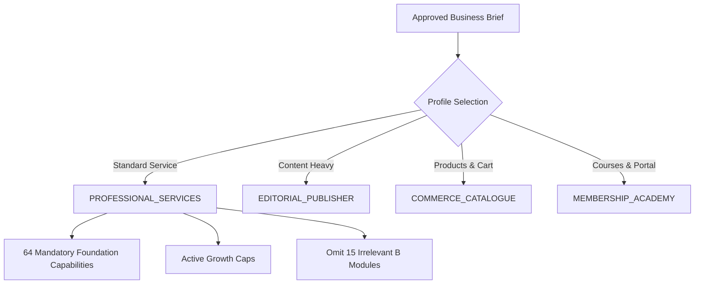

# ForgeStudio Executable Capability Manifest Specification
**Document Version:** 2.1.0  
**Blueprint Controlling Point:** Point 05 — Turn the Blueprint into an Executable Capability Contract  
**Manifest Engine:** `CAP-116`  
**Status:** Authoritative Runtime Manifest  

---

## 1. Role of the Executable Manifest

The Capability Manifest is the **declarative binding layer** connecting the 120 capabilities in the registry to real platform subsystems:

1. **Admin Navigation:** Dynamically constructs admin menu items, routes, and indicators reflecting the true server-side enablement state of capabilities.
2. **Backend Route & API Guards:** Rejects incoming API requests attempting to execute disabled or un-activated capabilities, regardless of client UI manipulation.
3. **Recipe & Website Profile Selection:** Governs automated site generation by mapping business briefs to profile recipes (`PROFESSIONAL_SERVICES`, `EDITORIAL_PUBLISHER`, `COMMERCE_CATALOGUE`, `MEMBERSHIP_ACADEMY`).
4. **Export Dependencies:** Discloses runtime dependencies and static compilation requirements in export manifests.

---

## 2. Profile Selection Architecture

ForgeStudio provisions websites through validated Profile Recipes:

### Invariant Rules:
- **Universal Foundation Invariant:** Every recipe unconditionally incorporates all 64 Universal Foundation (F) capabilities.
- **Conditional Omission Rule:** If a website brief does not require e-commerce, LMS, or booking functionality, those B modules are **completely omitted** from the generated navigation, sitemaps, and database entities.
- **Roadmap Preservation:** Inactive G capabilities remain tracked on the platform roadmap and are never removed from engineering scope.

---

## 3. Dynamic Admin Navigation Contract

Admin navigation is derived directly from the server-side capability manifest via `generateAdminNavigation()`:

| Navigation Item | Required CAP | Status if Active | Status if Inactive |
| :--- | :--- | :--- | :--- |
| **Website Overview** | `CAP-011` (Website CRUD) | `AVAILABLE` | `NOT_CONFIGURED` |
| **Visual Canvas** | `CAP-016` (Visual Editor) | `AVAILABLE` | `NOT_CONFIGURED` |
| **Design Tokens** | `CAP-021` (Global Tokens) | `AVAILABLE` | `NOT_CONFIGURED` |
| **Form Submissions** | `CAP-043` (Durable Leads) | `AVAILABLE` | `NOT_CONFIGURED` |
| **Truthful Claims** | `CAP-046` (Truthful Claims) | `AVAILABLE` | `NOT_CONFIGURED` |
| **Dynamic CMS** | `CAP-051` (Custom Post Types)| `AVAILABLE` | `NOT_CONFIGURED` |
| **SEO & Social** | `CAP-056` (SEO Metadata) | `AVAILABLE` | `NOT_CONFIGURED` |
| **WordPress Bridge** | `CAP-086` (WP Auth) | `AVAILABLE` | `NOT_CONFIGURED` |
| **Commerce & Products** | `CAP-101` (Product Catalogue) | `AVAILABLE` | `DISABLED` (B Module) |
| **Appointments** | `CAP-104` (Booking Engine) | `AVAILABLE` | `DISABLED` (B Module) |
| **Courses & Academy** | `CAP-106` (LMS Curriculum) | `AVAILABLE` | `DISABLED` (B Module) |
| **Community Forum** | `CAP-108` (Discussion Forum)| `AVAILABLE` | `DISABLED` (B Module) |
| **Publishing & Releases**| `CAP-093` (Release Hashing) | `AVAILABLE` | `NOT_CONFIGURED` |
| **Capability Governance**| `CAP-116` (Capability Manifest)| `AVAILABLE` | `LOCKED_ACTIVE` |
