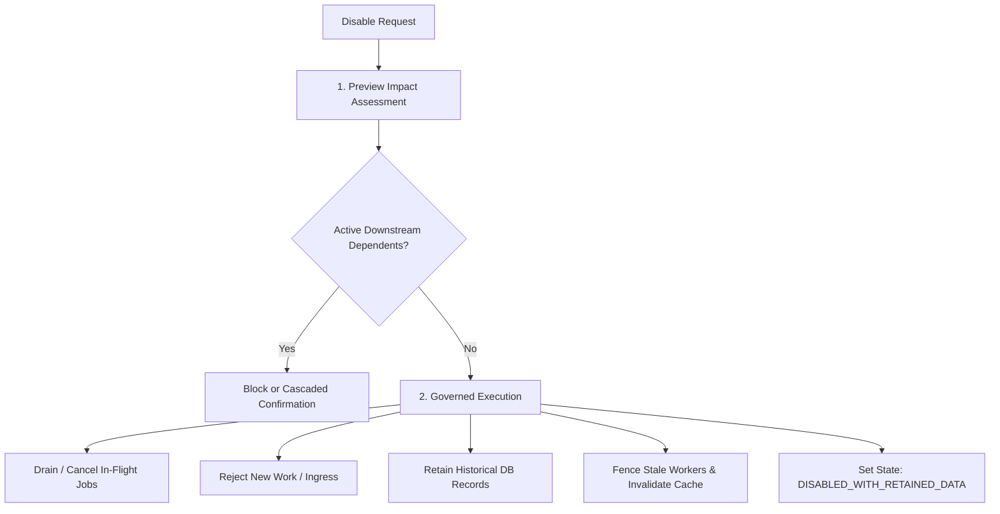

# ForgeStudio Lifecycle Governance & Release Gate Specification
**Document Version:** 2.1.0  
**Blueprint Controlling Point:** Point 05 — Turn the Blueprint into an Executable Capability Contract  
**Governing Engines:** `CAP-117` (Activation), `CAP-118` (Disable/Exit), `CAP-119` (Release Gate), `CAP-120` (Evidence Freshness)  
**Status:** Authoritative Governance Specification  

---

## 1. Governed Capability Activation (`CAP-117`)

A capability may transition to `ACTIVE` only after the `evaluateActivationPrerequisites()` engine validates all required preconditions.

### Prerequisite Checklist:
1. **Parent Dependencies:** All parent capabilities must already be in `ACTIVE` state.
2. **Encrypted Credentials:** Integrations requiring third-party API tokens (e.g. Stripe, SFTP, WordPress) must have verified credentials in the secrets vault.
3. **Consent & Data Purpose Approval:** Features collecting customer PII or tracking consent must have signed administrative sign-offs.
4. **Schema Migrations:** Underlying database models must be applied via Prisma migrations.
5. **Fresh Verification Evidence:** Must have non-stale passing test evidence (default 30-day window).

> [!IMPORTANT]
> **Safety Invariant:** Business waivers or exception overrides can **never** bypass prohibited data processing, missing mandatory credentials, or non-waivable security gates (`CAP-006`, `CAP-007`, `CAP-043`, `CAP-072`).

---

## 2. Governed Disable and Exit Lifecycle (`CAP-118`)

Disabling a capability or disconnecting an external integration is a **governed state transition**, not a simple UI toggle:

### Invariant Rules:
1. **No Silent Data Erasure:** Disabling e-commerce, forms, or CMS never drops or truncates database tables; business history and visitor leads are preserved.
2. **Stale Worker Fencing:** Job leasers and background workers check versioned capability state before processing, preventing delayed jobs from executing disabled tasks.
3. **Re-import Protection:** Restoring an older snapshot cannot implicitly reactivate disconnected integrations without running fresh prerequisite checks.

---

## 3. Profile-Aware Mandatory Release Gate (`CAP-119`)

Pre-publish verification in `publishing.service.ts` executes `evaluateProfileReleaseGate()` prior to generating public deployment artifacts.

### Zero-Tolerance Rules:
1. **No Blank = Passed:** Any missing, blank, or unevaluated check immediately fails the release gate.
2. **No Masking Critical Failures:** A high composite score (e.g. 98% visual quality) **cannot** offset an authorization failure, consent failure, or lead durability defect.
3. **Restricted Exceptions Only:** Non-critical exceptions require a named approver, explicit scope, recorded mitigation, and an active expiry date. Expired exceptions automatically cease to authorize releases.
