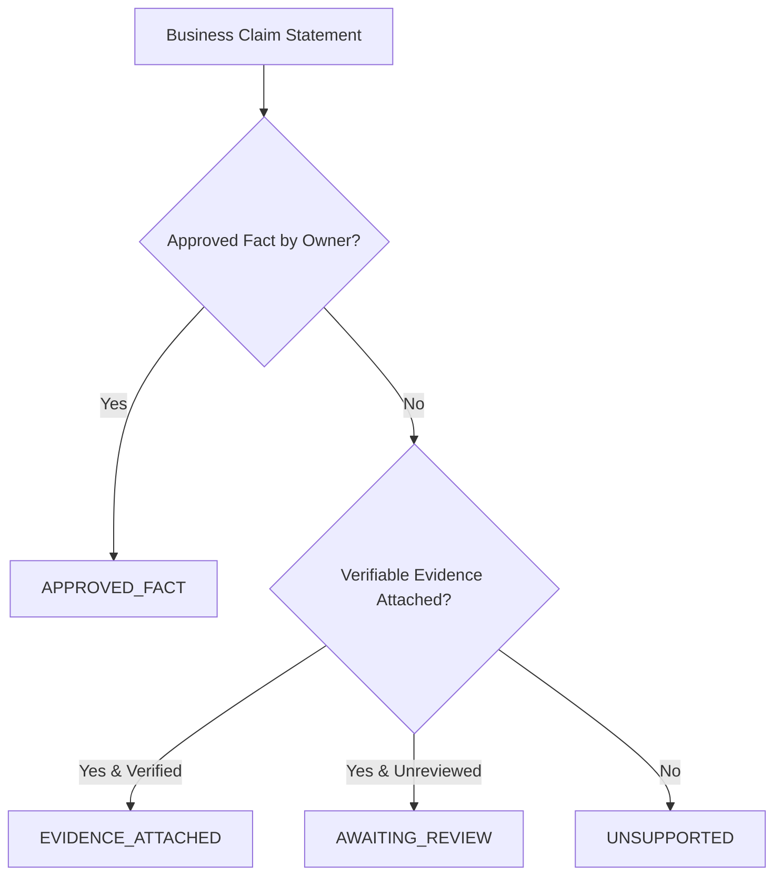

# ForgeStudio Truthful Claims and Evidence Policy
**Document Version:** 2.1.0  
**Blueprint Controlling Point:** Point 04 — What Every Generated Website Must Contain  
**Status:** Mandatory Editorial and Publishing Policy  

---

## 1. Controlling Invariant

ForgeStudio strictly forbids the automated fabrication of business claims, organizational credentials, testimonials, customer volume, awards, guarantees, or performance metrics.

Any material statement on a generated website must be traceable to an approved evidence reference or human sign-off.

---

## 2. Claim Classification Hierarchy

Every business claim processed by ForgeStudio belongs to one of four verifiable states:

1. **`APPROVED_FACT`:**
   - Statements explicitly supplied by the authorized business owner (e.g. founding year, headquarters, verified service description).
   - Traceable to authenticated user or verified business brief.
2. **`EVIDENCE_ATTACHED`:**
   - Statements supported by a verified citation, external accreditation registry, license number, or client-signed document.
   - Verified by an authorized reviewer.
3. **`AWAITING_REVIEW`:**
   - Statements with attached evidence that have not yet received human reviewer sign-off.
   - May be rendered in draft/staging previews, but blocks public production releases unless explicit policy override is granted.
4. **`UNSUPPORTED`:**
   - Statements lacking any citation, verifiable evidence, or authorized approval.
   - **Strictly prohibited:** Automatically blocked by pre-publish validation.

---

## 3. High-Risk Claim Categories

The following categories require explicit evidence verification prior to public deployment:

- **Metrics & Counts:** Statements claiming specific customer counts ("10,000+ happy clients"), retention percentages ("99.9% uptime"), or financial returns.
- **Accreditations & Awards:** Badges asserting "Award Winning", "Voted Best", "ISO Certified", or regulatory endorsements.
- **Customer Testimonials:** Direct quotes attributed to individuals or organizations must reference signed permissions.
- **Pricing & Guarantees:** Unconditional satisfaction guarantees ("100% money back") or fixed price commitments.
- **Health & Financial Outcomes:** Any claim concerning health benefits or investment earnings.

---

## 4. Pre-Publish Enforcement

Pre-publish validation in `publishing.service.ts` inspects all page contracts. If any `UNSUPPORTED` claims are detected or if `AWAITING_REVIEW` claims remain unresolved under strict mode:

1. The deployment pipeline halts immediately with status `VALIDATION_FAILED`.
2. Actionable error messages identify the exact page, claim ID, and statement.
3. The working production release remains completely uninterrupted.
